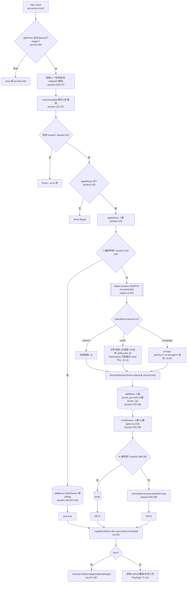

# F1 对局会话与引擎核心 + F2 象棋规则层 — Phase 1 流程图

## 1. Sources consulted

ws-server.ts:213-220,385-541,696-714,543-557;game-session.ts:115-167,169-202,204-362,372-433,435-450,457-512,523-544,553-604,606-619;engine/engine.ts:36-115,117-147;director/director.ts:5-62;rules/position.ts:77-180;rules/adjudicate.ts:29-70;rules/describe-move.ts:44-73;types.ts:1-40,112-136;games-repo.ts:18-89;schema.sql:1-21;stimulus-kind.ts:14-38;player-state.ts:9-27;defaults.ts:24-32;PlayPage.tsx:70-145,230-244,297-345,381-390;ws-client.ts:3-9,16-103;MoveList.tsx

## 2. F1 主链流程图

副分支:new(ws:420,黑方 aiFirstMove:433)/pause·resume(ws:491-496 仅 pausedGames,**不碰钟**)/spectators(:497)/say(:469)/resign(:504,先快照钟:507)/draw_offer(:512,RNG 应答 session:565-577)/undo(:523,仅 coach+moves≥2 session:584-587)

## 3. F2 Position 生命周期

fromFen(position:83)→legalMoves(:109)→applyMove(:126,不可变)→key/inCheck(:150/158)→adjudicate(adjudicate:29 三次重复/60回合/长将)→isGameOver(:166);**describeMoveZh(describe-move:44)不走 Position,自带第二套 FEN 解析器**(:9)——两套解析器需手工保持一致(历史坑 OPEN-ISSUES #1)。

## 4. 数据字段表(要点)

games:started_at 近乎纯展示(排序用 ended_at);start_fen 无校验(§5-8)。
moves:**ply 列写而不读**(session 用 getMoves().length 重算 :287);**fen_after 不用于重放**(重放靠 move+startFen,仅 reflect/诊断/陪练读);**人着 score_cp 恒 null**(:246/279)。
**schema 无时钟列——时钟纯内存,从不落库。**

update 帧:clockState.startedAt 内部剥离不下发(:533);blackRemaining AI 侧几乎恒为初始值。

异常字段:
- **decision.reason 写了从不读**(director:12/40/59 生成教练解释文案,全库无消费者)⚠️
- **undoRemaining 仅前端 useState(3)**(PlayPage:39),服务端零计数 ⚠️
- EngineLine.pv F1 路径不消费(中置信)

## 5. 业务闭环观察(半接线/死代码/不合理)

1. **时钟超时不判负**:全库无 flag-fall 逻辑,归零夹 0 即停(session:526-531,PlayPage:299)→ 时钟纯装饰 ⚠️
2. **AI 侧钟冻结**:playHumanMove 结尾恒 activeSide=humanSide(:356-360),AI 同步应手不占钟;aiFirstMove 不碰钟 → 对手钟恒 600s ⚠️
3. **pauseClock 死代码**(session:536,codegraph No callers)+ WS pause 不停钟 → **暂停的墙钟时间在 resume 后扣给人类**(:207)⚠️
4. **时钟不持久**:clockStates 仅 newGame 写(:194),ensureLoaded 不重建 → 重启后钟静默消失(if(clock) 守卫保走子)
5. **悔棋不回滚裁决状态**:undoLastMoves(:579-604)不清 repeatHistories/noCapturePlies → 三次重复/60 回合裁决被污染 ⚠️
6. **悔棋上限仅前端**:自造客户端/断线重连 useState 重置→无限悔棋
7. **draw_offer 纯 RNG**(coach .8/humanlike .6,session:565-577),不看局面 → 大优也可能接受和棋
8. **startFen 无校验且先落库后解析**(session:170→171):非法 FEN 产生无着法孤儿 games 行
9. 人着实时 blunder 靠 AI 应手 swing≥150 反推(:345),真实人评分等局后诊断(合理代理,但注意)
10. **无引擎+执黑=死局**:黑方无 aiFirstMove(ws:433 需 engine)且 move 被 :447 挡 → 不可玩

闭环正确处:resign/draw 先快照钟再清态(ws:507/515);finish 清 10 Map;onStimulus gate;人着先算后写。

## 6. 依赖/Confidence/盲区

elephantops(rank1-10 与 pikafish rank0-9 差 1,elToPika 桥接);Pikafish UCI 子进程(cwd 找 nnue);better-sqlite3。Confidence:高(时钟三缺陷/死代码均 grep+callers 佐证)。盲区:uci-parse.ts 未通读;时钟 AI 冻结为静态推断。
