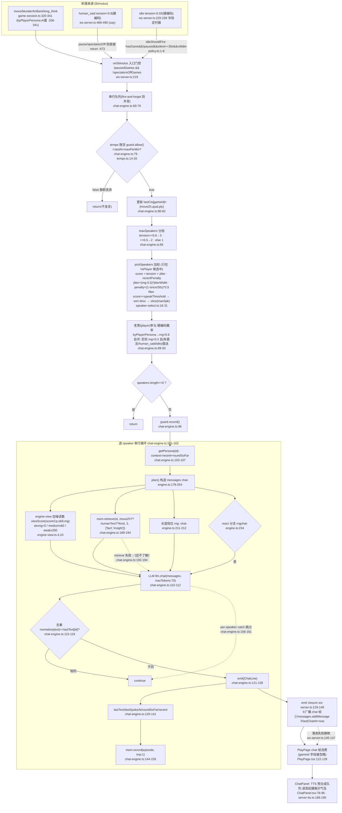

# F3 观棋者聊天编排 — Phase 1 流程图

## 1. Sources consulted (file:line)

Server (orchestration core)
- `server/src/chat/chat-engine.ts:42-262` — `ChatEngine`, `onStimulus`(:69), `handleStimulus`(:78), `plan`(:178)
- `server/src/chat/tempo.ts:1-27` — `TempoGuard.allow/record`
- `server/src/chat/speaker-select.ts:13-32` — `pickSpeakers` 加权
- `server/src/chat/idle-policy.ts:1-8` — `idleShouldFire`
- `server/src/personas/engine-view.ts:4,10-16` — `NOISE_CP` / `viewScore`
- `server/src/personas/personas.ts:3-24` — `PERSONAS`(老黑=player)
- `server/src/config/defaults.ts:1-32` — `ChatCfg` 默认值
- `server/src/config/runtime-config.ts:22,64-76` — `getChat` / `personas` / `getPersona`
- `server/src/session/game-session.ts:260-264,320-341,413-420` — move 刺激发射
- `server/src/session/stimulus-kind.ts:14-38` — `classifyMoveKind` / `baseTensionForKind`
- `server/src/ws-server.ts:124-150`(装配+emit)`,219`(gating)`,222-244`(idle timer)`,442-490`(move/say)`,497-503`(spectators)
- `server/src/memory/store.ts:31-43`;`server/src/store/messages-repo.ts:16-43`;`server/src/store/schema.sql:68-77`;`server/src/types.ts:104-136`

Web (consumption)
- `web/src/api/ws-client.ts:7`;`web/src/pages/PlayPage.tsx:122-128,286,504-507`;`web/src/chat/ChatPanel.tsx:22-27,78-96,182-206`;`web/src/voice/server-tts.ts:100-195`;`web/src/pages/ReviewPage.tsx:16,122-132`

## 2. Mermaid flowchart

## 3. 数据字段表

### messages 表 (schema.sql:68-77)

| 列 | 生产 | 消费 | 结论 |
|---|---|---|---|
| id | autoincrement | ReviewPage key | ✅ |
| game_id | ws-server.ts:138/:479 | /games/:id:555→ReviewPage/GamesTab | ✅ |
| persona_id | ws-server.ts:139/:479('human') | ReviewPage:128;GamesTab:54 | ✅ |
| role | ws-server.ts:140/:479 | **仅接口声明,无渲染消费** | ⚠️准死列 |
| text | ws-server.ts:141/:479 | ReviewPage:130/GamesTab:54/ChatPanel:202 | ✅ |
| addressee | ws-server.ts:143/:479('all') | **持久列无人读**(live 显示走 WS 帧) | ⚠️只写不读 |
| ts | ws-server.ts:142/:476 | ReviewPage:125/ChatPanel:199 | ✅ |

### chat 帧字段(ws-server.ts:131/:485)

| 字段 | 前端消费 | 结论 |
|---|---|---|
| gameId | **PlayPage:122-128 未读** | ⚠️帧里有、live 丢弃(串局风险:换局瞬间旧帧无从过滤) |
| personaId/text/ts | avatar/气泡/TTS/时间戳 | ✅ |
| addressee | ChatPanel:23-27 "→ 你"装饰标签 | ✅(弱用途) |

### tension 生产→消费
- 生产:baseTensionForKind(stimulus-kind.ts:31-38 blunder/brilliant .95, long_think .70, move .50);吃子溢价 max(base,0.9)(game-session.ts:257,317,333);aiFirstMove |cp|/300(game-session.ts:413);human_said 0.9 硬编码(ws-server.ts:490);idle 0.55 硬编码(ws-server.ts:238)
- 消费:maxSpk 分档 chat-engine.ts:85;打分基线 speaker-select.ts:19

## 4. 业务闭环观察

- **chat 控制台 9 字段全部有真实消费点**(minSilenceMs/maxPerMin→tempo.ts:15-19;idleProb→idle-policy.ts:7;idleIntervalMs→ws-server.ts:241;speakThreshold→speaker-select.ts:28;jitterWidth→:20;reactProb→chat-engine.ts:234;lenShortP/lenLongP→:211-212 累积阈值)✅
- **addressee**:服务端广播不按它路由(ws-server.ts:132-134 无差别推送);唯一消费=live 气泡"→ 你"标签;**持久化列只写不读**;ReviewPage 不读 → 回放丢失"谁在跟谁说话"
- **role 列准死**:前端区分人类靠 personaId==='human'(ChatPanel:82),role 无渲染消费
- **观众席关闭=完全静场**:say 在 ws-server.ts:473 直接 return——**连玩家自己的话都不回显不落库**(玩家视角:发言消失,无提示)
- **老黑参与概率 0.6/0.3 硬编码**在 chat-engine.ts:89-93,不在 ChatCfg,控制台改不了;player skill='strong'→读数零噪声
- **human_said tension=0.9 / idle tension=0.55 硬编码**(ws-server.ts:490/238),不可配

## 5. 依赖/Confidence/盲区

依赖:F9 LLM(maxTokens70)、F4 记忆(retrieve/record)、F11 配置、F7 TTS(前端)。Confidence: High(核心文件逐行读)。盲区:retrieve 融合排序内部在 F4 报告;概率分档的实际观感未实测。
