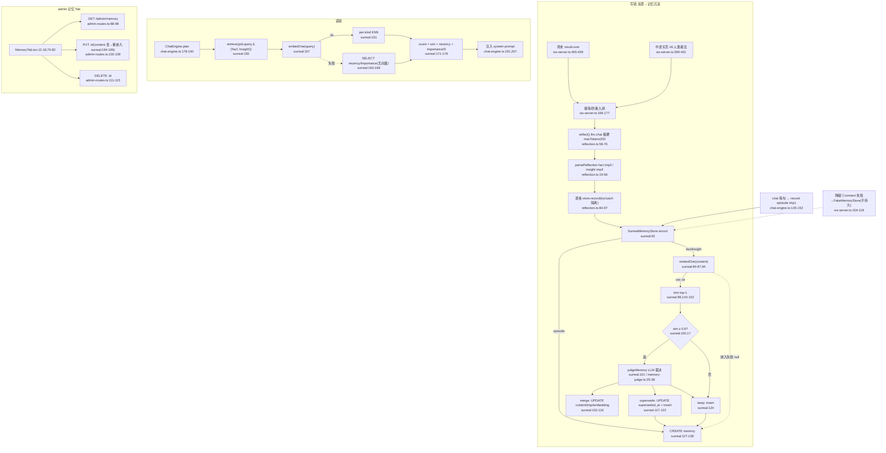

# F4 角色语义记忆(SurrealDB)— Phase 1 流程图

## 1. Sources consulted (file:line)

- `server/src/memory/reflection.ts:19-101`;`memory/store.ts:1-43`;`memory/surreal-memory-store.ts:8-223`;`memory/memory-judge.ts:9-38`;`memory/fake-memory-store.ts:8-55`
- `server/src/llm/embedding.ts:1-31`;`llm/dashscope-embedding.ts:6-43`
- `server/src/ws-server.ts:100-119,166-211,355-372,385-468`;`admin/admin-routes.ts:87-134`;`store/games-repo.ts:65-74`
- `web/src/api/admin.ts:7-68`;`web/src/pages/console/MemoryTab.tsx:1-94`
- 消费:`chat-engine.ts:128-160,178-207`

## 2. 流程图(写链+读链)

## 3. memory 表字段(DDL surreal:63-75)

| 字段 | 生产 | 消费 | 结论 |
|---|---|---|---|
| id | CREATE surreal:130-137 | update/remove/merge WHERE;admin | ✅ |
| persona_id | surreal:131 | KNN/list/retrieve WHERE;索引 :74 | ✅ |
| kind | reflection:41,44/chat:147 | 分支:93;过滤:148,155,185 | ✅ |
| content | :131;merge:109;admin:194 | prompt 注入;judge 输入;admin 显示 | ✅ |
| importance | 3/4:reflection;1:chat:149;merge min(5,+1) | 融合 importance/5:175;admin | ✅ |
| game_id | :131(reflection:91/chat:150) | **无 WHERE/聚合;MemoryTab 不显示** | ⚠️只写不查;deleteGame 不清→悬挂 |
| created_at | reflection:81/chat:151 | recency 衰减:173;ORDER BY:188 | ✅ |
| superseded_at | supersede:119 | 状态过滤:148,166,186 ✅;**时间戳值仅 MemoryTab 删除线,且默认 list 不含已作废→死代码** | ⚠️半闭环 |
| embedding | :131;merge:109;re-embed:196 | KNN 算子:148;HNSW:73 | ✅;episode 永不写 |

## 4. 业务闭环观察

- **episode 只写不读**:retrieve 唯一调用点显式 ['fact','insight'](chat-engine.ts:190);episode 与 SQLite messages 表双写冗余,唯一消费=admin 浏览
- **judge 降级不对称**:parseJudge 解析失败→keep(安全,memory-judge.ts:21);**judgeMemory 调用抛错无 try/catch(surreal:101)→冒泡→该条记忆彻底丢失**(reflection.ts:94-96 warn 跳过)
- **deleteGame 不清 Surreal**(games-repo.ts:66-74 仅 5 张 SQLite 表)→ 记忆 game_id 悬挂,孤儿累积
- **FakeMemoryStore 降级完全无感知**:仅服务端 warn;MemoryTab 照常列出内存行,无"未持久化"提示
- **HNSW 维度风险**:索引 IF NOT EXISTS(surreal:73),改 EMBEDDING_DIM 旧索引不重建→维度不匹配
- **融合打分量纲**:sim+recency+importance/5 三项无归一化,recency/importance 可盖过语义相似度(surreal:175)

## 5. 依赖/Confidence/盲区

依赖:SurrealDB(ws://127.0.0.1:8000,4s 超时降级)、DashScope text-embedding-v3(dim1024)、LLM(反思+judge)。Confidence: High(主干逐行)。盲区:Surreal 部署脚本;维度迁移;打分权重设计意图。
