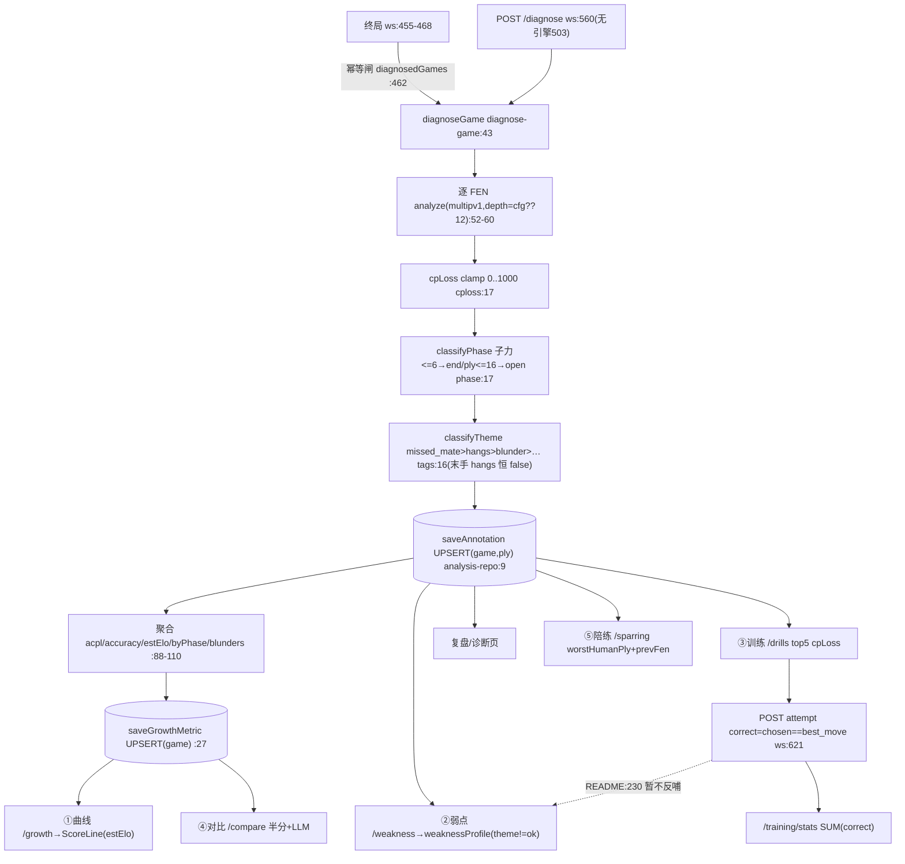

# F5 局后诊断 + F6 成长训练 — Phase 1 流程图

## 1. Sources consulted (file:line)

diagnose-game.ts:32-113;cploss.ts:8,17;phase.ts:4-21;tags.ts:10-23;elo.ts:2,7;analysis-repo.ts:9-68;training-repo.ts:20-44;schema.sql:26-65;games-repo.ts:68,76-89;generate-drills.ts:13-32;compare.ts:18-52;sparring.ts:11-26;llm-report.ts:8-42;ws-server.ts:250-277,420-441,455-468,544-665;game-session.ts:372-396;types.ts:48-84;http-client.ts:3-47;AnalysisPage:18-114;ReviewPage:38-141;GrowthPage:38-180;TrainingPage:19-134;PlayPage:148-190;README:188-230,297-310

## 2. Mermaid

## 3. 数据字段表

**move_annotations(schema:26-36)**:8 列全闭环 ✅(best_move 被 drill 判定消费 ws:621);**只存 best_move 不存 played_uci**(走的那手来自 moves 表)。

**growth_metrics(schema:39-52)— 写而未读重灾区**:
| 列 | 消费 | 状态 |
|---|---|---|
| game_id/analyzed_at/acpl/accuracy/est_elo/blunders | 曲线/对比/表格 | ✅ |
| human_side | 仅 mapGrowth:64 | ⚠️写而未读 |
| opening_acpl/midgame_acpl/endgame_acpl | 仅 mapGrowth:65-66 | ⚠️写而未读(算了存了没人看) |
| mistakes | compare 只用 blunders | ⚠️写而未读 |
| result | 胜率走 games.result | ⚠️写而未读 |

**drill_attempts(schema:57-65)**:correct 仅 SUM 聚合 ✅;**ply/chosen_move/created_at 纯写入从不 SELECT** ⚠️;insert 返回 id 被丢弃(ws:623);**此表无 FK→games**(对比 annotations:28 有)。

## 4. 业务闭环观察

1. **训练数据死胡同**:drill_attempts 只进 /training/stats;weaknessProfile 只查 annotations;**generateDrills 不排除已答对的题(练对了下次还出)**(generate-drills:19-21)
2. **compare 隐患**:按 analyzed_at(诊断时间)非对局时间切半(ws:641-644)——重诊断旧局会挪进 after 半区;red/black 混池(human_side 未用)
3. **sparring 执黑伪错误**:human=black 时 FEN 轮黑走,PlayPage new 触发 aiFirstMove(ws:433),守卫 session:379-380 抛 "not AI turn"→ 前端吃 error 帧(棋局其实已建好可玩)⚠️逻辑对红不对黑
4. **diagnosedGames 重启安全**:内存闸丢失但 UPSERT 幂等,最坏重跑引擎不重复数据 ✅
5. **LLM growthReport 静默降级**:失败回退规则 summary,前端无感 ✅(设计如此)
6. **Analysis/Review 端点冗余**:两端点各查 game+moves 再各补 annotations/messages,互不为超集,可合一
7. **⚠️疑似真 bug:GrowthPage.tsx:155 `(m.accuracy*100).toFixed(1)%`,而 accuracyFromAcpl 已返回 0..100(elo.ts:2)→ 显示 ~7160%**(中置信,待运行验证)

## 5. 依赖/Confidence/盲区

引擎(诊断硬依赖,depth 热更);LLM 仅 growthReport;better-sqlite3(FK ON,但 drill_attempts 无 FK)。Confidence:字段表高;#7 中(静态)。盲区:图表组件内部;多实例并发诊断。
