# F7 TTS 输出 + F8 ASR 输入 — Phase 1 流程图

## 1. Sources consulted (file:line)

服务端:ws-server.ts:294-350(moss 进程管理)/768-793(GET /tts)/795-815(POST /asr)/357-363(static)/281-292(错误脱敏);voice/moss-tts.ts:1-233;voice/voice-profiles.ts:1-64;voice/dashscope-asr.ts:1-34;voice/asr.ts:1-14;config/defaults.ts:10-31;runtime-config.ts:25,78-88;validate.ts:54;settings-repo.ts:5,32-52;admin-routes.ts:39,72;chat-engine.ts:111
前端:voice/server-tts.ts:1-196;browser-tts.ts:1-82;voice-config.ts:1-16;use-speech-input.ts:1-102;wav.ts:1-28;ChatPanel.tsx:78-172;PlayPage.tsx:215/247/287/508;api/config.ts:6-12
运行态实证:server/static/tts/ 现存 23 wav ≈40MB;assets/tts/ 5 个参考音。

## 2. Mermaid(TTS 链 + 解锁/静音 + ASR 链)

```mermaid
flowchart TD
    subgraph TTS["F7 TTS(弹幕→声音)"]
        A["弹幕到达 ChatPanel:78"] --> A1{"human 或 muted? :82"}
        A1 -->|是| A2["markReady 立即揭示 :84"]
        A1 -->|否| B["speakServer server-tts:168"]
        A --> A6["6s 兜底揭示 :91"]
        B --> C["立即 fetch GET /tts 预热 :173"]
        C --> D{"queue>=3? :187"}
        D -->|是| D1["丢最旧+fireStart :188-190"]
        D --> E["入队→drain :194"]
        E --> G{"未解锁? :102"}
        G -->|是| G1["滞留(不播不兜底)"]
        G -->|否| H["await urlPromise :112"]
        C -.-> S1["GET /tts ws-server:772"]
        S1 --> S3["voiceProfileForPersona :79"]
        S3 --> S5{"streaming? moss-tts:60"}
        S5 -->|true| S6["流式消费 /audio→wrapPcm16Wav :90-161"]
        S5 -->|false| S7["synthesizeOnce /api/generate :188"]
        S6 --> S8["writeFileSync static/tts/{id}.wav :63"]
        S7 --> S8
        S8 --> S9["{url} :784"]
        S9 -.-> H
        H -->|reject| I["fireStart+browserSpeak 兜底 :117"]
        H -->|resolve| J["audio.src;fireStart;play :127-133"]
        J --> L["onended→下一条 :136"] --> H
        I -.-> BR["browser-tts:51 voiceParam→pitch/rate"]
    end
    subgraph ASR["F8 ASR(说话→say)"]
        Z1["点麦 use-speech-input:32"] --> Z3["MediaRecorder :45"]
        Z3 --> Z5["stop→Blob :52"] --> Z6["decodeAudioData→downsampleMono16k→encodeWav :85-98"]
        Z6 --> Y1["POST /asr(4MB limit) ws-server:797"]
        Y1 --> Y2{"mime 格式正则 :799"} -->|ok| Y5["DashscopeAsr.transcribe :24"]
        Y5 --> Y7["{text} :810"] -.-> Z9["onResult→onSay ChatPanel:99"]
        Z9 --> Z10["ws say PlayPage:508"]
    end
```

## 3. 数据字段表

- **TtsCfg**:mossNanoUrl(默认:31;消费 startMossTts:303 + moss-tts base:95/193)✅;referenceAudio(仅 resolveReferenceAudio 第二顺位兜底:32)✅;streaming(:60 分流)✅
- **VoiceProfile 7 字段全部真传 moss**(stream:99-105/once:197-203 逐字段 append;referenceAudio→prompt_audio Blob)✅ 无死字段
- **persona_config.tts_voice**:只覆盖 referenceAudio(runtime-config:85),**6 个采样参数控制台不可调**
- **VOICE_PARAMS(voice-config.ts)**:唯一消费 browser-tts:61 → **仅浏览器兜底路径存活**;服务端 wav 播放用不上(音色已烤进 wav)
- **static/tts/*.wav 生命周期**:写 moss-tts:63/74(uid 每次新文件,无 dedup);读 fastifyStatic:360;**清理:全仓 grep unlink/rm 零命中 → 无限堆积**(实证 23 文件 40MB,重启不清、无 TTL、无上限)⚠️
- **assets/tts/wanfeng.wav**:无默认档引用,仅控制台可选(孤儿备选)

## 4. 业务闭环观察

1. **双层背压阈值同为 3 但语义不同**:server-tts 丢最旧保 2+1(:187-190);browser 兜底 pendingCount>2 全清只留最新(browser-tts:55);回退时可能连续两次丢弃
2. **静音停不掉服务端已入队语音**:setMuted 只 speechSynthesis.cancel(browser-tts:35),不动 server-tts queue/audioEl;drain 循环不复检 isMuted(:106-141)→ 中途静音后当前句+已入队句继续播完;硬停 stopVoice 仅由暂停/重开/关观众席触发(PlayPage:215/247/287)⚠️
3. **500 字截断=防御性死代码**(双重截断 ws-server:779 + moss-tts:55;弹幕 maxTokens70≈50-70 字永不触发)
4. **ASR mime"白名单"实为语法正则**(:799),类型受控靠前端转码;任意合法 MIME 串可过
5. **兜底两漏点**:A 未解锁期间既不播也不兜底,句子声音彻底丢失(仅 6s reveal 保气泡);B /tts 200 但 wav 损坏→onerror resolve 静默跳过不兜底(:132)
6. **moss 卡死场景 UX**:activing-but-wedged 时请求吊满 60s 才 503→兜底;冷启动数秒纯兜底期

## 5. 依赖/Confidence/盲区

依赖:moss-tts-nano(:18083,spawn 托管,MOSS_TTS_BIN/DEVICE/TEXT_NORMALIZATION);qwen3-asr-flash(30s 超时);浏览器 SpeechSynthesis/MediaRecorder。Confidence:高(逐行+grep+目录实证)。盲区:moss 内部行为依注释;fastifyStatic 缓存头;4MB≈128s 音频为推算。
