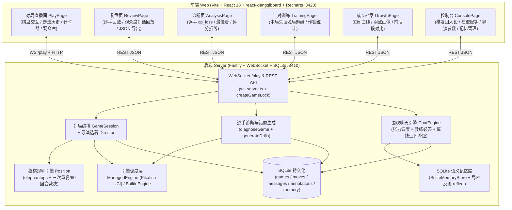

# 围观象棋 · Weiguan Xiangqi

> **有人味、有性格、有记忆的中国象棋 AI 陪练与茶馆围观直播间**  
> **An AI-Powered Chinese Chess (Xiangqi) Coaching & Tea-House Spectator Companion**

[](./LICENSE)
[](https://nodejs.org/)
[](https://www.typescriptlang.org/)

---

## 目录 / Table of Contents

- [项目简介 / Overview](#项目简介--overview)
- [核心特性 / Key Features](#核心特性--key-features)
- [系统架构 / Architecture](#系统架构--architecture)
- [引擎准备与跨平台降级说明 / Engine Setup & Built-in Fallback](#引擎准备与跨平台降级说明--engine-setup--built-in-fallback)
- [快速开始 / Quickstart](#快速开始--quickstart)
- [环境变量说明 / Environment Variables](#环境变量说明--environment-variables)
- [测试与深度 E2E 指南 / Testing & Playwright E2E](#测试与深度-e2e-指南--testing--playwright-e2e)
- [目录结构 / Directory Structure](#目录结构--directory-structure)
- [开源协议 / License](#开源协议--license)

---

## 项目简介 / Overview

**围观象棋 (`weiguan-xiangqi`)** 是一款将 **中国象棋对弈指导**、**局后逐手失分诊断（ACPL / 估算 Elo / 弱点画像 / 失误残局训练）** 与 **多角色性格化茶馆观棋弹幕 + 语音互动** 融为一体的全栈应用。

Unlike traditional silent chess GUIs, **Weiguan Xiangqi** recreates the lively atmosphere of a traditional street-side Xiangqi tea house:
1. **Dynamic Director Coaching (`coach` / `humanlike` modes)**: Adjusts AI candidate move selection using MultiPV evaluation bands so the game stays engaging ("within reach") rather than crushing beginners or throwing blatantly.
2. **Tea-House Spectator Crew**: Four distinct personas (**林教练 Coach Lin**, **炮儿爷 Grandpa Pao**, **吃瓜阿强 Netizen A-Qiang**, and the AI player **老黑 Old Hei**) see differentiated noisy engine evaluations according to their chess skill level, banter with each other, answer player questions in real time, and form long-term SQLite semantic memories across games.
3. **Closed-Loop Growth Flywheel**: Automatically runs move-by-move centipawn-loss (`cp_loss`) diagnosis after each game, builds an opening/midgame/endgame weakness radar, generates targeted blunder drills from your own games, and tracks your estimated Elo curve over time.

---

## 核心特性 / Key Features

| 模块 / Module | 核心能力 / Capabilities |
| :--- | :--- |
| **1. 双模式导演对弈 (Director Gameplay)** | 支持 **陪练模式 (`coach`)**（动态控盘、连败让渡、悔棋支持、选着意图解释）与 **拟人对手 (`humanlike`)**（贴近真人棋风）；支持执红先手/执黑后手一键切换、走棋计时器与断线状态自愈 (`resync`)。 |
| **2. 围观棋友团与长期记忆 (Spectators & Memory)** | 四位性格迥异的棋友实时评棋；引入张力调度器 (`TempoGuard` + `pickSpeakers`) 控制发言节奏；玩家提问 (`coach_query`) 必答并结合当前局面引擎主变解答；局末自动触发反思 (`reflect`) 写入 SQLite 长期记忆库。 |
| **3. 语音播报与听写降级 (Voice TTS & ASR)** | 支持阿里云百炼 `qwen3-tts-flash` 预合成流水线与 `qwen3-asr-flash` 语音提问；未配置云端密钥时自动回退浏览器原生 Web Speech API 与确定性离线棋友点评，全程零崩溃。 |
| **4. 逐手失分诊断与成长飞轮 (Diagnosis & Growth)** | 逐手计算 `cp_loss`、阶段划分（开/中/残局）与失误标签（漏杀 `missed_mate`、丢子 `hangs_piece`、大漏着 `blunder`、失误 `mistake`）；自动生成针对性错题训练 (`drills`)、弱点雷达图与历史对比成长报告。 |
| **5. 零外部依赖开箱即玩 (Zero-Config Fallback)** | 内置基于 `elephantops` 与子力/位置/1-ply 战术搜索的确定性 UCI 兼容象棋引擎 (`BuiltinEngine`)，未配置 `PIKAFISH_PATH` 或无 DashScope API Key 时仍可完整跑通对弈、诊断、弹幕、复盘与全套 E2E。 |

---

## 系统架构 / Architecture



---

## 引擎准备与跨平台降级说明 / Engine Setup & Built-in Fallback

本项目支持两档引擎模式，**克隆仓库后无需任何额外二进制即可直接运行**：

1. **默认模式：内置确定性 UCI 兼容引擎 (`BuiltinEngine`)**
   - 当未设置 `PIKAFISH_PATH` 或指定路径不存在时，后端自动启用 `server/src/engine/builtin-engine.ts`。
   - 内置引擎基于 `elephantops` 严格象棋规则生成合法着法，结合子力价值、过河兵/中路位置加分、将杀检测与 1-ply 对手最强反击采样，完整支持 **执红/执黑对弈、MultiPV 导演控盘、局面洞察问答与局后逐手失分诊断**。
2. **可选增强：原生 Pikafish NNUE 高强度引擎**
   - 如需大师级棋力，可从 [Pikafish 官方 Releases](https://github.com/official-pikafish/Pikafish/releases) 下载对应平台二进制与 `pikafish.nnue` 权重文件放入 `./engine/` 目录，并通过环境变量指定：
     ```bash
     export PIKAFISH_PATH=./engine/pikafish
     ```
   - 即使外部二进制运行异常，`ws-server` 也会通过 `ManagedEngine` 自动重连并无缝回退至 `BuiltinEngine`，确保对局永不中断。

---

## 快速开始 / Quickstart

### 1. 环境要求 / Prerequisites

- **Node.js**: `>= 20.0.0`
- **npm**: `>= 9.0.0`

### 2. 安装依赖 / Install Dependencies

```bash
git clone git@github.com:liuwenpinghaher-commits/weiguan-xiangqi.git
cd weiguan-xiangqi
npm install
```

### 3. 启动开发环境 / Start Development Servers

```bash
# 终端 1：启动后端服务（默认监听 http://127.0.0.1:3410）
npm run dev:server

# 终端 2：启动前端页面（默认监听 http://localhost:3420）
npm run dev:web
```

浏览器打开 `http://localhost:3420` 即可开始对局。点击顶部导航栏「控制台」（`#/console`）可随时在线调整四位围观棋友的人设脾气、导演控盘参数或配置百炼/本地 Ollama 模型。

---

## 环境变量说明 / Environment Variables

可复制根目录 `.env.example` 为 `server/.env`（所有外部密钥均为可选）：

| 变量名 / Variable | 默认值 / Default | 必填 | 说明 / Description |
| :--- | :--- | :---: | :--- |
| `HOST` | `127.0.0.1` | 否 | 后端监听地址（默认仅本机回环，安全隔离） |
| `PORT` | `3410` | 否 | 后端 HTTP / WebSocket 监听端口 |
| `DB_PATH` | `~/.weiguan-xiangqi/weiguan.sqlite` | 否 | SQLite 数据库存储路径 |
| `PIKAFISH_PATH` | 空（自动启用 `BuiltinEngine`） | 否 | 外部 Pikafish 可执行文件路径 |
| `DASHSCOPE_API_KEY` | 空（自动启用离线棋友点评） | 否 | 阿里云百炼 API Key（用于云端对话、TTS 与 ASR） |
| `DASHSCOPE_BASE_URL` | `https://dashscope.aliyuncs.com/compatible-mode/v1` | 否 | OpenAI 兼容模型推理 Base URL（亦可在控制台配本地 Ollama） |
| `DASHSCOPE_TTS_MODEL` | `qwen3-tts-flash` | 否 | 云端语音合成模型名称 |
| `ASR_MODEL` | `qwen3-asr-flash` | 否 | 云端语音识别模型名称 |
| `FRONTEND_ORIGINS` | `http://localhost:3420,http://127.0.0.1:3420` | 否 | 允许跨域访问后端与 WebSocket `/play` 的前端源白名单 |
| `VITE_PORT` | `3420` | 否 | 前端 Vite 开发服务器端口 |
| `VITE_API_BASE` | `http://localhost:3410` | 否 | 前端连接的后端地址 |

---

## 测试与深度 E2E 指南 / Testing & Playwright E2E

### 1. 单元测试、集成测试与类型检查

```bash
# 一键运行后端单测/集成测试 (56 files / 420 tests) + 前端单测 (11 files / 48 tests) + 双端 TypeScript 类型检查
npm test

# 构建前后端生产产物
npm run build
```

### 2. Playwright 真实业务深度 E2E 测试

E2E 测试通过 `e2e/start-e2e-servers.mjs` 在独立隔离端口（后端 `:18310`、前端 `:18320`）与临时 SQLite 目录中自动拉起完整服务，测试结束后自动销毁全部子进程与临时文件：

```bash
npm run test:e2e
```

E2E 完整覆盖以下 5 大真实业务闭环：
1. **开局选难度与围观棋友团配置**：验证控制台（`#/console`）四位棋友角色配置、运行参数面板，以及对局页「陪练 / 拟人对手」模式切换。
2. **走子交互与合法性校验**：点选「炮二平五」（`h3 -> e3`）验证 `/legal-moves` 合法落点计算与走子上屏，并注入非法着法验证服务端拦截与前端回退提示。
3. **AI 引擎应对与逐手失分诊断**：验证 AI 自动应手、认输终局收尾，进入诊断页（`#/analysis/:id`）执行逐手 `cp_loss` 诊断与最佳着法标注，并在成长页（`#/growth`）核验估算 Elo 与 ACPL 指标。
4. **棋友团弹幕点评与无 Key 语音优雅降级**：验证无 `DASHSCOPE_API_KEY` 时玩家发送弹幕提问触发教练必答回复，切换语音播报静音开关全程零 `pageerror`。
5. **复盘报告生成闭环**：进入复盘页（`#/review/:id`）验证「上一手 / 下一手」局面步进与「观众席回放」历史对话归档。

---

## 目录结构 / Directory Structure

```text
weiguan-xiangqi/
├── server/                     # 后端服务 (Fastify + WebSocket + SQLite)
│   └── src/
│       ├── admin/              # 控制台管理 API 与密钥脱敏掩码
│       ├── analysis/           # 逐手 cp_loss 计算、阶段分类、主题标签与局后诊断
│       ├── chat/               # 围观棋友弹幕引擎、张力调度与叙事构建
│       ├── config/             # 运行时热配置 (代码默认 ⊕ SQLite 覆盖)
│       ├── director/           # 陪练/拟人双模式导演选着控制器
│       ├── engine/             # BuiltinEngine 内置引擎、Pikafish UCI 封装与 ManagedEngine
│       ├── llm/                # DashScope / Ollama / 离线确定性点评 Provider
│       ├── memory/             # SQLite 语义记忆库、局末反思与记忆去重裁判
│       ├── personas/           # 四位棋友团角色定义与差异化棋力噪声视图
│       ├── report/             # 历史对比与成长报告生成
│       ├── rules/              # elephantops 象棋规则适配、坐标转换与中文着法描述
│       ├── session/            # 对局会话状态机、走棋钟与并发锁
│       ├── store/              # SQLite 表结构与仓储层
│       ├── training/           # 失误残局训练题生成
│       ├── voice/              # 云端 TTS/ASR 封装
│       └── ws-server.ts        # HTTP 与 WebSocket 路由总入口
├── web/                        # 前端工程 (Vite + React 18 + TypeScript)
│   └── src/
│       ├── api/                # HTTP / WebSocket 客户端与契约
│       ├── board/              # 象棋棋盘组件 (Board) 与走法列表 (MoveList)
│       ├── charts/             # 评分曲线 (ScoreLine) 与弱点雷达图 (WeaknessRadar)
│       ├── chat/               # 观众席弹幕与语音交互面板 (ChatPanel)
│       ├── pages/              # 对局、复盘、诊断、成长、训练、控制台六大页面
│       └── voice/              # 服务端预合成播放队列与浏览器 Web Speech 降级
├── e2e/                        # 隔离端口 Playwright 深度 E2E 测试套件
├── docs/                       # 架构设计与多轮系统审计归档
├── .env.example                # 环境变量模板
├── CONTRIBUTING.md             # 贡献指南
├── SECURITY.md                 # 安全策略
└── LICENSE                     # MIT 开源许可证
```

---

## 开源协议 / License

本项目采用 [MIT License](./LICENSE) 开源（`Copyright (c) 2026 Liu Wenping`）。  
若自行下载使用外部 [Pikafish](https://github.com/official-pikafish/Pikafish) 引擎二进制，请遵守其上游 GPLv3 协议。
